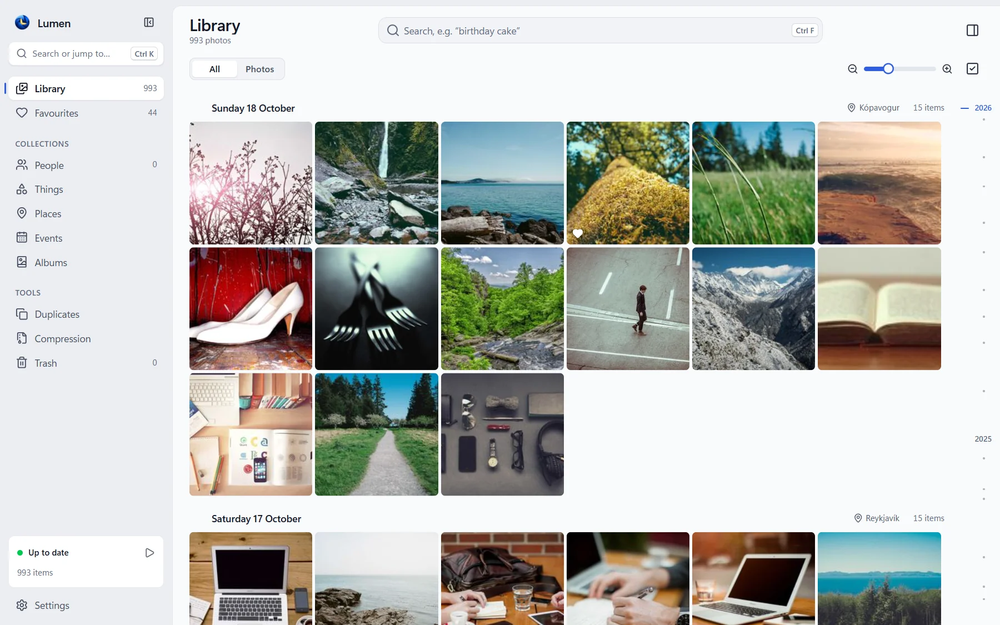
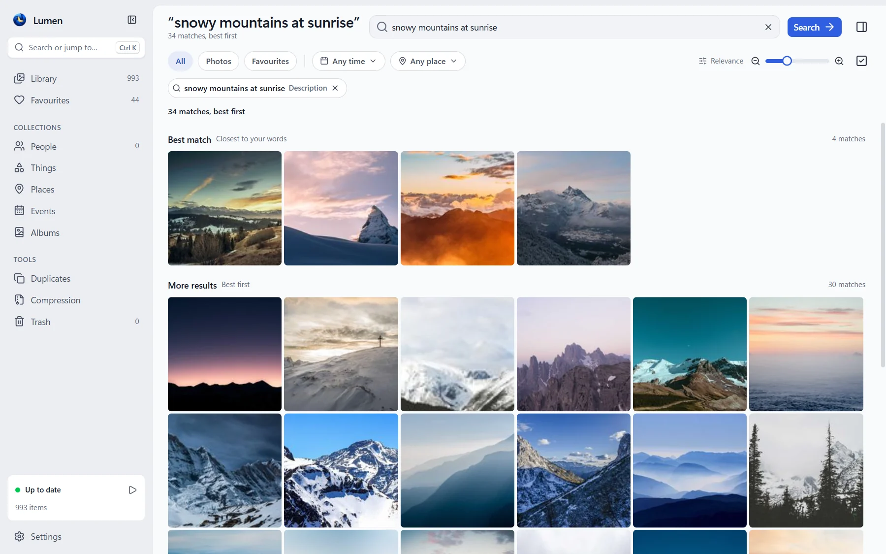
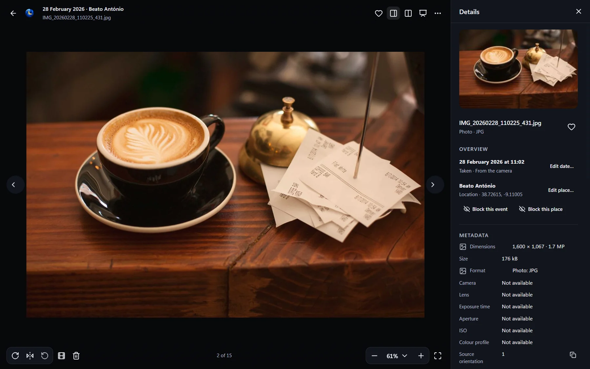
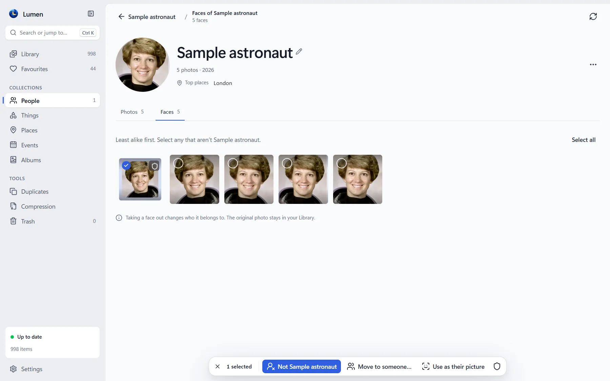
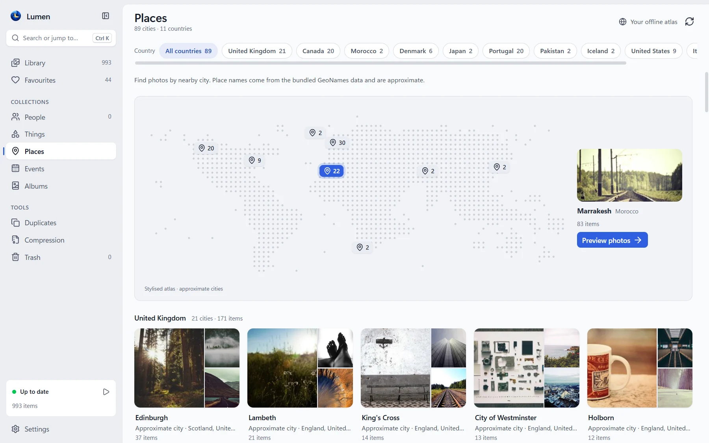
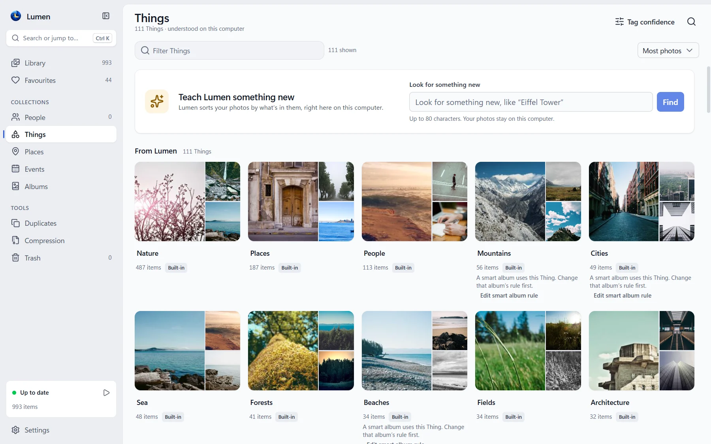
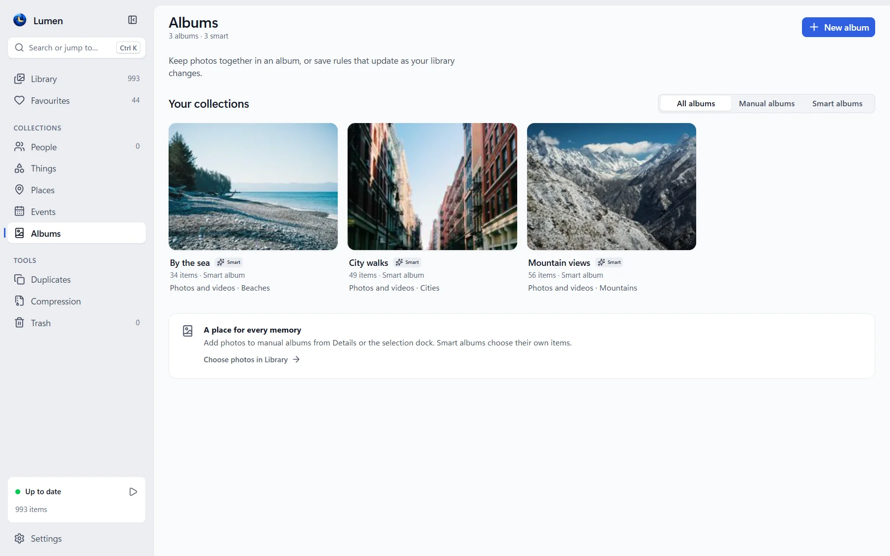
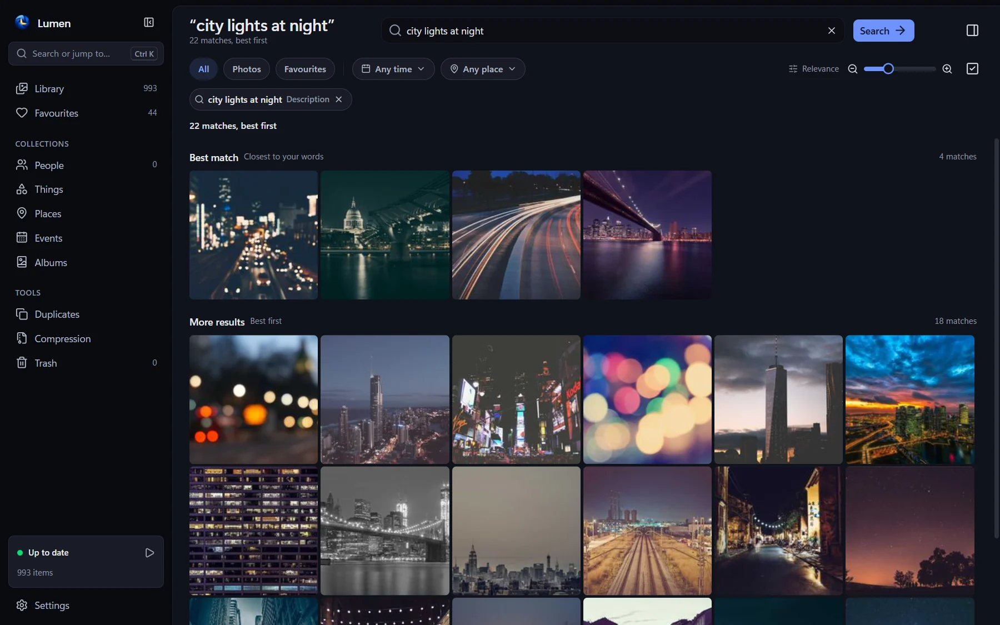

# Lumen

A Windows desktop gallery for photos and videos, organised by AI that runs on
your own PC. Browse by day, find a scene by describing it, name the people in
your photos and keep albums, without uploading anything. No account, no
uploads, no telemetry.

- **Find a memory:** search by what is in a photo, by a person's name, or by text in screenshots and documents.
- **Explore:** People, Things, Places, Events, favourites, and manual and smart albums.
- **View:** photos, camera RAW, HEIC, JPEG XL, animations, multi-page images and video.
- **Stay in control:** correct faces and tags; hide or block anything behind a PIN.
- **Careful with files:** originals are never edited. Moves and renames are
  previewed and can be undone, deleting goes to the Windows Recycle Bin, and
  compression saves new copies for you to review.

New here? Follow [the walkthrough](docs/using-lumen.md), or read [everything Lumen does](docs/features.md).

## Installing

1. From [Releases](https://github.com/awaisjameel/lumen/releases), download
   `Lumen-<version>-x64-setup.exe` and `SHA256SUMS.txt`. (The runtime ZIP is for
   update tooling; install with the setup program.)
2. Check the download against `SHA256SUMS.txt`, in PowerShell with
   `Get-FileHash .\Lumen-0.12.0-x64-setup.exe`, or in Git Bash with
   `sha256sum -c SHA256SUMS.txt --ignore-missing`.
3. Close Lumen if it is running, and run the setup program. It installs for
   you alone, in `%LOCALAPPDATA%\Programs\Lumen`, with no administrator prompt.
   It carries Microsoft's WebView2 runtime for PCs without it, so installing
   needs no internet either.

Lumen needs Windows 10 or 11 (64-bit); 8 GB of memory or more is recommended. A
graphics card speeds up the AI, which also runs on the processor alone. The
installer is not signed yet, so Windows warns before running it:
[release status](docs/release-status.md) explains what has and has not been
checked. Upgrading, uninstalling and what to test are in
[the beta guide](docs/beta-testing.md#installing).

## Your first library

1. Open Lumen. The welcome screen suggests folders such as Pictures; choose
   them or add your own, then choose **Start browsing**. Lumen reads your
   photos where they are: it does not copy, import or move them.
2. Photos and thumbnails appear first. The AI then works through them in the
   background, and the activity card at the bottom of the sidebar says what it
   is doing (select it for details). People, Things and search fill in as it
   goes. It pauses on battery, behind a full-screen game or video, and while
   the PC is busy; **Settings → Indexing and performance** changes that.
3. Press `Ctrl+F` and describe a photo: `dog on a beach`, `birthday cake`. Name
   someone in **People**, then search for their name. Open a photo and press
   `I` for its details; `Esc` closes the details, then the viewer.
4. Add more folders, or include videos, in **Settings → Library and folders**.
   A folder inside one already added is included with it.

[The walkthrough](docs/using-lumen.md) has worked examples for correcting faces
and tags, albums, blocking, duplicates, moving files, compression and settings.

## Screenshots

| Search by describing a photo | The viewer with its details |
| --- | --- |
|  |  |
| **Naming and correcting people** | **Places, on an offline atlas** |
|  |  |
| **Things, found automatically** | **Smart albums** |
|  |  |

**The dark theme**

The sample photos are from [Unsplash](https://unsplash.com/license), by way of
[Lorem Picsum](https://picsum.photos), with a public-domain NASA portrait for
People; their dates, places and names are invented.
[All screenshots, their sources and how to capture them again](docs/screenshots/README.md).

## Privacy and the network

Your photos, thumbnails, faces and searches stay on your PC. The AI models,
FFmpeg and the city database ship in the installer, and Lumen makes no network
request.

The one exception is an **opt-in updater**, which is built but inert: its
trust configuration (`internal/update/release-config.json`) is empty, so no
build from this repository contacts a server. Turning it on needs a publisher
certificate, offline signing keys and hosting ([production signing](docs/production-signing.md)).
Until then, install a new version over the old one with the installer. The
releases link in **Settings → Updates and about → About Lumen** opens your
browser only when you click it.

Lumen keeps its library and settings in `%LOCALAPPDATA%\Lumen`. It never edits
your originals. It changes files in your folders only when you ask: renaming
or moving them, writing XMP sidecars if you turn them on, or sending them to
the Recycle Bin. Blocking hides things inside Lumen; it does not encrypt files
or hide them from other programs. A problem report stays on your PC until you
share it, and can contain file paths: [check it first](docs/beta-testing.md#sending-a-problem-report).

## Status

Lumen is in beta. As checked on **24 October 2026**, the latest release is
[v0.12.0](https://github.com/awaisjameel/lumen/releases/tag/v0.12.0), unsigned.
The source has changed since, with the same version number, so a build from it
is not that release. [Release status](docs/release-status.md) separates what
is published, what was accepted and when, and what is still to do before a
signed release.

### Known limits

- Windows 10 and 11 (64-bit) only. The macOS, Linux and mobile build templates are untested.
- The installer is not signed yet, so Windows SmartScreen warns before installing it.
- English only, interface and text recognition alike. Videos and text recognition are off until you turn them on.
- Face recognition, Things and search can be wrong; your corrections always win.
- Compression saves new copies only (same-format replacement with Undo is not
  included), skips sources over 16 megapixels or 256 MiB, and keeps the newest 100 runs.
- Developed RAW and rendered HEIC/TIFF viewing copies are limited in size, and
  some DNG compression is not read: see [the format limits](docs/beta-testing.md#known-limits-of-this-beta).

## Help and troubleshooting

| What you see | What to try |
| --- | --- |
| Photos appear, but search or People seem incomplete | Select the activity card in the sidebar: the AI may still be working, or paused (battery, busy PC, full screen). People needs clear faces in at least three photos. |
| Videos are missing | Turn on videos in **Settings → Library and folders**, and check the formats left out there. |
| A photo seems missing | Check the Library's filters, the Trash, removed folders and **Settings → Privacy and blocked**. |
| A file can't be read, or compression skips it | Read the reason Lumen gives: the format, its size, its metadata or damage can each stop it. |

For anything else, [save a problem report](docs/beta-testing.md#sending-a-problem-report),
check it for private paths, and [open an issue](https://github.com/awaisjameel/lumen/issues/new)
with your Lumen and Windows versions, what you did, and what you expected. The
[beta guide](docs/beta-testing.md) lists what is most useful to test.

## Building from source (Windows)

- [Development](docs/development.md): toolchains, first-time setup, building,
  packaging, the tests and checks, and CI.
- [CONVENTIONS.md](CONVENTIONS.md): how code is written here. Read it before
  changing code.
- [Architecture](docs/architecture.md): the repository's layout, how Lumen
  works, and [where it deliberately departs from the original plan](docs/architecture.md#deviations-from-the-plan).
- [Releasing](docs/releasing.md), [release status](docs/release-status.md) and
  [production signing](docs/production-signing.md).
- [The documentation map](docs/README.md) names the one place each topic is
  explained; [the history](docs/history/README.md) keeps the dated records.

## Licence

Lumen is licensed under the [PolyForm Noncommercial License 1.0.0](LICENSE)
(`PolyForm-Noncommercial-1.0.0`): its source is available, but it is not open
source, and commercial use is not permitted; read the licence for its terms.
The components it ships keep their own licences, listed in
`THIRD_PARTY_NOTICES.txt` and in **Settings → Updates and about → About Lumen → Licences**.
