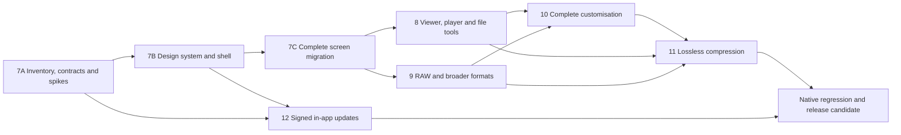

# Lumen: frontend and media development plan

Date: 4 October 2026. Status: Phase 7 is implemented (see
[the Phase 7 record](phase7-design-2026-10-04.md)) and so is Phase 8 (see
[the Phase 8 record](phase8-implementation-2026-10-05.md)); Phases 9–12 are
planned and not started.

This plan covers the product owner's four requests: rebuild the complete
frontend with the latest stable Nuxt UI, expand viewing and file tools,
support more formats, and provide more useful customisation. The owner chose
a calm, photo-focused visual direction and camera RAW/DNG as the first
format priority. The owner also requested individual and bulk lossless
image compression, specified in Phase 11 below, and automatic update
checking, background preparation and a prompted restart in Phase 12.
Installation and reinstallation acceptance were reported
as passed by the owner; the existing beta remains the regression baseline.

The sequence below extends the roadmap with Phases 7–12. These are planned
development phases, not claims of completion or a decision to publish a
new version. Existing Phase 5/6 decisions and AUDIT_CONVENTIONS.md still
apply except the owner's explicit update-only network policy change in
Phase 12. Version numbering is settled when a release candidate is assembled.

## 1. Architecture and scope

Keep Go, Wails, Vue, Vite, Vue Router, Pinia and TanStack Virtual. Nuxt UI
supports standalone Vue through its Vite and Vue plugins; this frontend
rebuild does not require a Nuxt server or an SSR migration. Rebuild every
screen and interaction on the new system while retaining the existing
domain stores, bridge, visibility rules and durable backend workflows.

Technical facts checked for this plan:

| Area             | Current implementation                                                                          | Implication                                                                                |
| ---------------- | ----------------------------------------------------------------------------------------------- | ------------------------------------------------------------------------------------------ |
| Frontend         | Vue 3, Vite 8, Router 5, Pinia 4; handwritten CSS and controls                                  | Verify Nuxt UI integration against these versions before migrating screens.                |
| Shared behaviour | Typed bridge, list stores, save queues, error reporting, i18n and keyboard helpers              | Extend these owners; do not introduce parallel service calls, state or error pipelines.    |
| Image viewer     | 1024 px preview, then original for web-native photos; previous/next and details                 | Add a proper viewing controller and a rendered-image path for other formats.               |
| Video viewer     | Native controls, direct playback with conversion fallback; converted seeks start another stream | Own controls can improve UX, but source-time seeking and cancellation must remain correct. |
| Details          | Date/source, dimensions, camera, location, tags, albums, faces and paths                        | Group existing data clearly; add new metadata through generated contracts.                 |
| Preferences      | Engine settings in SQLite; theme and grid zoom in localStorage                                  | Establish one durable preference owner and migrate existing choices.                       |
| File mutations   | `internal/fileops` owns recycling, journalled moves and sidecar writes                          | New copy/export/rename operations belong here, with conflict and recovery rules.           |

Nuxt UI **4.11.3** is the latest stable release checked on 4 October 2026.
Its npm publication was 1 October 2026 at 13:37 UTC. The repository keeps
`min-release-age=7`; this version becomes eligible after 8 October at
13:37 UTC / 18:37 Pakistan time. Preserve that setting. Design and contract
work can start immediately; if integration starts earlier, use the newest
compatible stable version that passes the age rule, then move to the
latest eligible stable version before the migration milestone closes.
Recheck versions at installation and commit the lockfile. Do not use a v5
prerelease for this rebuild.

The integration spike checks TypeScript 6, Router 5, Vite 8, the Wails Vite
plugin, the strict ESLint import boundary, test setup, licence generation
and production embedding. No unrelated toolchain upgrade is part of it.

### Ownership

| Owner                                | Responsibility                                                                                                                                                        |
| ------------------------------------ | --------------------------------------------------------------------------------------------------------------------------------------------------------------------- |
| `frontend/src/design/`               | Semantic tokens, Nuxt UI theme overrides, density, breakpoints, motion and the icon manifest.                                                                         |
| `frontend/src/shared/`               | Reusable Lumen compositions: page headers, feature states, media tiles, selection bars, metadata rows and preference controls. Existing shared utilities remain here. |
| `frontend/src/app/`                  | Shell, navigation, global overlays and command/shortcut presentation; `App.vue` remains the root.                                                                     |
| Existing feature folders             | Dedicated screens, workflows and feature stores. Features share compositions and keep their own domain behaviour.                                                     |
| `frontend/src/media/`                | Shared image controller, video controller, filmstrip, comparison and media actions, reached through existing viewer sources.                                          |
| `frontend/src/bridge/`               | All Wails imports, generated types, event subscriptions and engine calls.                                                                                             |
| `internal/core`, `store`, `services` | Canonical wire contracts, persistence and validated service access.                                                                                                   |
| `internal/media`, `index`            | Decoder capabilities, rendered media, cache policy and background jobs.                                                                                               |
| `internal/fileops`                   | Changes in user folders, including new export/copy operations.                                                                                                        |

Use Nuxt UI controls directly when they meet the need. Introduce a Lumen
component when it shares product behaviour or a recurring composition;
avoid wrapping every library component just to rename it. Specialised
virtual grids, zoom surfaces and video timelines remain purpose-built.

## 2. Phase 7 — Complete frontend and design system

### 7A. Baseline, contracts and integration

- Inventory every route, overlay, action, shortcut and current preference.
  Capture representative baseline screens and important failure states.
- Define the media capability and preference contracts needed by later
  phases, so screens are built around capabilities rather than extensions.
  Run small RAW and rendered-image feasibility spikes early.
- Install eligible Nuxt UI, Tailwind CSS 4 and a local icon collection.
  Add the Vite plugin alongside Wails, the Vue plugin and one root `UApp`;
  set root isolation and generated theme/type aliases as documented.
- Keep icons, fonts and other assets local. Explicitly bundle dynamic
  icons from the command registry; source scanning alone does not find
  every TypeScript-generated icon name. Disable remote icon fallback and
  any external font loading. Verify the packaged UI with external network
  requests rejected and a fresh WebView cache.
- Retain one theme state owner. Translate system/light/dark into the
  classes and semantic tokens Nuxt UI needs, including portal content.
  Replace theme and overlay providers as their consumers migrate.

Exit: the production Wails app renders a representative page, dialog,
menu, tooltip, form and toast with correct theme, focus, strict types and
offline assets. Integration evidence names the versions actually tested.

### 7B. Design language and app foundations

Create a centrally configured visual system:

- Neutral surfaces, restrained blue accent by default, strong photo
  emphasis, clear hierarchy and system fonts. Curated accent choices come
  from the same token set; status colours keep their meaning.
- Semantic colours, typography, spacing, corner radii, borders, elevation,
  focus rings, control sizes, disabled states and overlay layers.
- Comfortable and compact density; controls on coarse pointers provide
  larger targets. UI text scaling works without truncating required actions.
- Wide desktop: resizable sidebar and inline inspector. Medium width:
  collapsed navigation and optional inspector. Narrow width: navigation
  drawer, overflow actions and inspector sheet. Initial content-width
  breakpoints are 1200 and 900 CSS px, tuned by native-window testing.
- One page header, breadcrumb/context treatment, toolbar, filter pattern,
  action menu, confirmation, toast/Undo, empty state, loading state,
  recoverable error and background-work presentation.
- A shared command registry connects toolbars, context menus, command
  palette and shortcuts. Availability is computed from the selected media,
  view, gate state, capabilities and in-flight actions. The backend remains
  the authority for every operation.
- One overlay coordinator handles modal stacking, Escape ownership, focus
  trapping/restoration and shortcut suspension. Portalled Nuxt UI menus
  replace assumptions that only native `dialog[open]` needs checking.
- Subtle motion tokens: roughly 100–160 ms for control feedback and
  160–220 ms for panels. Prefer opacity/transform; avoid per-tile animation
  during indexing or scrolling. Honour reduced motion and forced colours.
  Informative loading states must still work when motion is disabled.

Build a local development-only component showcase with light/dark,
densities, narrow layouts, long labels, keyboard focus and failure states.
It is the reference for reviewing later screens; it ships no debug route
in the production app.

Exit: approved direction is expressed by tokens and reusable compositions;
the shell works at narrow widths, high DPI and keyboard-only navigation.

### 7C. Dedicated UX for every module

| Module                      | Planned experience                                                                            | Behaviour to retain                                                                           |
| --------------------------- | --------------------------------------------------------------------------------------------- | --------------------------------------------------------------------------------------------- |
| Onboarding                  | Clear folder selection, suggested folders, first-scan progress and useful error recovery.     | Non-overlapping sources, canonical path comparison and incremental browsing.                  |
| Library, Favourites, Videos | Consistent media toolbar, timeline, density/size controls, filters, thumbnails and selection. | Virtualisation, on-screen priority, shared scoped timeline and live changes.                  |
| Search                      | Focused search surface, suggestions, filter chips and clear indexing/no-result feedback.      | Relevance order, person constraints, OCR precedence and blocked-name behaviour.               |
| People                      | Recognisable cards, naming/merge flows and a dedicated face-review workspace.                 | User corrections win; named/blocked identities are not merged automatically.                  |
| Things                      | Searchable label collection, built-in/custom distinction, pinning and rename/reset.           | Prompt identity, confidence rules and explicit user edits.                                    |
| Places                      | Location cards and a focused place timeline with clear approximate-city information.          | Offline GeoNames, live visibility-aware counts; no online map tiles.                          |
| Events                      | Event cards, names, pinning, regrouping explanation and contextual timeline actions.          | Event tags follow their photos through splits and regrouping.                                 |
| Albums                      | Separate manual/smart collection treatments and a clear typed rule editor.                    | Membership survives moves; counts and rules remain live.                                      |
| Duplicates                  | Side-by-side review, best-copy explanation, selection summary and confirmation.               | Similarity is a suggestion; exact copies and similar assets have different removal semantics. |
| Trash                       | Distinct recovery workspace, selected restore, recycle preview and Undo where supported.      | No automatic emptying and no permanent disk deletion.                                         |
| Blocked                     | Dedicated locked/unlocked states, block editor and covered-media browser.                     | PIN limits, Windows recovery, idle locking and immediate access revocation.                   |
| Organise files              | Template editor, dry-run table, conflict explanations and progress/history/resume/undo.       | Journalled moves, no overwriting, privacy filters and scan coordination.                      |
| Settings                    | Searchable categories with descriptions, inline validation and saving feedback.               | Existing options and saved values survive the redesign.                                       |
| About, diagnostics, notices | Coherent version/licence/report surface, crash notice and problem-report guidance.            | Local logs, cancellable report saving and no automatic sending.                               |

Collection cards share presentation. Scoped pages still use the canonical
timeline engine with feature-specific headers and actions; dedicated UX
does not mean duplicated asset fetching or selection logic.

Migrate the shell and library first, then viewer/details, collections and
review workflows, finally settings/onboarding/diagnostics. Each slice
replaces its previous controls and styles, updates tests and passes native
smoke before the next slice. Temporary CSS aliases have named consumers
and are removed before Phase 7 closes. The milestone ends with all screens
migrated, unused CSS/icons/components removed and one notification and
overlay system. Later phases add features to this new interface.

## 3. Phase 8 — Viewing, playback, details and file tools

Implemented locally on 5 October 2026. See the [implementation and verification record](phase8-implementation-2026-10-05.md) for delivered behavior, measured native evidence and remaining acceptance boundaries. The scope below remains the design reference.

### 8A. Image viewer

Provide fit-to-window, actual-size, pointer-centred zoom, wheel/pinch zoom,
drag-to-pan, keyboard zoom, double-click zoom and a reset control. Show
the effective zoom and constrain pan after resize. Preserve EXIF
orientation and colour conversion without applying either twice.

Add an optional virtual filmstrip, fullscreen, auto-hiding controls,
slideshow with pause/speed/loop, and two-image comparison with optional
linked zoom/pan. Navigation follows the active viewer source, including
search order and the Blocked browser. Slideshow/comparison are bounded
requests, never a second full-library query.

Provide non-destructive rotate/flip display adjustments, kept as library
presentation metadata with reset. Apply them consistently in viewer,
comparison and thumbnails; transform face-region overlays accordingly.
Indexing uses the canonical source pixels, so these display changes do
not silently recluster faces. Export can optionally bake them into a new
copy. Source originals are untouched.

The original/rendered-image path must support appropriate resolution for
HEIC, TIFF and RAW, not just enlarge the existing 1024 px thumbnail.
Introduce bounded, cancellable render requests with source revision,
requested size, decoder version and adjustment version in cache keys.
Tile exceptionally large images when whole-image rendering exceeds the
decode budget; show an honest available-resolution limit until that path
is ready. A low-resolution embedded RAW preview is labelled as such.
Bound prefetch to adjacent items and cancel it on navigation or gate lock.

### 8B. Video player

- Consistent accessible controls: play/pause, volume/mute, time display,
  seek bar with preview, skip intervals, playback speed, loop and fullscreen.
- Clear buffering, direct/converting playback and recoverable error states;
  keyboard shortcuts respect text inputs, sliders and open overlays.
- Accurate source-time seeking, including a search result's matching
  timestamp. A single controller owns playback state and stream generations.
  Rapid seeks cancel obsolete conversion processes and restore play/pause,
  volume, speed and selected tracks on the new stream.
- Discover audio/subtitle tracks through ffprobe and expose supported
  selections through typed contracts. Convert supported text subtitles to
  local WebVTT when required; unsupported bitmap tracks show an explanation.
  Direct and converted track switching have separate native acceptance.
- Optional resume position, off by default, with clear-history support.
  Do not store blocked-browser history. Locking or hiding an asset clears
  active playback and invalidates its rendered/stream access.
- Save the current frame to a user-selected destination as an explicit
  export operation, with overwrite handling and cancellation.

### 8C. Details, thumbnails, selection and actions

Details become a resizable inspector with Overview, Metadata, Organisation
and Files sections. Add camera/lens and exposure information where readers
provide it, colour profile, orientation, animation/page information and
video frame rate/resolution/track information. Distinguish capture date
from its inferred source; missing values are explicit, not invented.
Metadata fields can be copied. Tags, people, albums and privacy controls
reuse their existing authoritative workflows.

One media tile handles all grid/card/filmstrip uses: aspect-ratio policy,
stable placeholder, progressive loading, selected/focused/hover states,
duration/animation/format indicators, favourite state and a context menu.
Hover video previews are bounded and pause offscreen. Reused DOM nodes
cannot show a previous asset's image, sprite or selection.

Add Ctrl-click and Shift-range multi-selection, select-visible and explicit
select-all-results. Across virtualised pages, selection uses stable IDs or
a backend-resolved, revision-bound query, with an honest count. It never
requires mounting every item or trusting stale frontend filters.

| Action group             | Planned actions and safeguards                                                                                                                                                                       |
| ------------------------ | ---------------------------------------------------------------------------------------------------------------------------------------------------------------------------------------------------- |
| Existing library actions | Favourite, tags, album membership, block, Trash/restore, recycle and reveal; shared availability and batch summaries.                                                                                |
| OS hand-off              | Open in the default app, explicit Open with where Windows supports it, copy path/name and reveal the chosen copy of a duplicate. Services validate the asset and path.                               |
| File copy/rename/move    | Explicit preview of affected paths, collisions and owned sidecars; no overwriting by default. Extend the existing file-operation journal, coordinate scans and preserve asset identity.              |
| Export                   | Export selected originals or rendered copies; choose destination, format, size and quality supported by tested encoders. Describe which metadata is included and offer privacy-preserving stripping. |
| Batch outcomes           | Per-item succeeded/skipped/failed/cancelled results; durable progress for file changes and Undo only for operations that actually have a valid reversal.                                             |

Clipboard file transfer is a separate Windows capability from copying a
path; expose it only once native support is implemented and tested.
Disk changes never occur as a side effect of viewing or changing a theme.
Locked/blocked/trash scopes retain their existing narrower action sets.
Actions are revalidated at execution, including between preview and commit.

Cropping, colour/exposure editing, retouching and general video editing
need a separate editing design. They are follow-up candidates rather than
implicit requirements of zoom, playback or format support. Independent
star ratings also need an explicit XMP rule: current favourites export as
five stars and must not silently acquire conflicting rating semantics.

## 4. Phase 9 — RAW first, then broader format coverage

Current recognised image extensions are JPEG/JPE, PNG, GIF, WebP, BMP,
TIFF, HEIC/HEIF and AVIF. Video extensions are MP4/M4V/MOV, AVI, MKV,
WebM, 3GP, WMV and MTS/M2TS. Recognition is not proof that every codec,
animation, page, camera variant or full-resolution path works.

Replace dispersed format lists with a canonical typed format catalogue
in the lower layer, consumed by scanner and media services. Keep decoder
selection in `internal/media`. Return actual capabilities to the UI:
metadata, static preview, full render, animation/pages, direct playback,
converted playback, AI input and export. Combine compiled support with
runtime probes; use file inspection rather than extension alone to decide
what a particular file can do. Unsupported variants explain why and do
not retry forever.

| Order | Format work                                                                                                                           | Acceptance boundary                                                                                                                                   |
| ----- | ------------------------------------------------------------------------------------------------------------------------------------- | ----------------------------------------------------------------------------------------------------------------------------------------------------- |
| 9A    | DNG and RAW families: Canon CR2/CR3/CRW, Nikon NEF/NRW, Sony ARW/SR2/SRF, Fujifilm RAF, Olympus/OM ORF, Panasonic RW2 and Pentax PEF. | Publish a tested camera/compression matrix. Recognising a family does not promise every model.                                                        |
| 9B    | Animated GIF/WebP/AVIF/APNG and multi-page TIFF handling.                                                                             | Distinguish static thumbnail/AI representative frame from animation/page browsing. Advertise only decoder-proven capabilities.                        |
| 9C    | JPEG XL decoding/reconstruction for Phase 11; candidate PSD composite previews and HEIF/AVIF improvements.                            | JPEG XL must support viewing/indexing/restoration before compression ships. Other candidates require fixture checks; PSD layers remain outside scope. |
| 9D    | Additional useful video containers, prioritised from the user's corpus: MPEG/MPG, TS, OGV and ASF candidates.                         | Test container plus video/audio codec combinations, seeking, duration, rotation, fallback and cancellation with the bundled FFmpeg.                   |

Evaluate a pinned LibRaw-based decoder for RAW in a Windows worker process,
so malformed or huge inputs have a process lifetime and resource budget.
Compare its embedded-preview extraction and rendered output on real camera
fixtures before choosing the integration. LibRaw documents camera-specific
support and dual LGPL/CDDL licensing; record the selected redistribution
mode and optional dependency licences in the build's notices. No codec or
camera SDK is downloaded at runtime.

RAW handling must extract full dimensions and metadata even when using an
embedded preview, preserve orientation, choose a documented white-balance
and colour policy, and report when only preview extraction works. AI,
faces and perceptual hashing share the canonical render path. A RAW+JPEG
pair is initially two assets, not an exact duplicate; any later visual
grouping must preserve both files and avoid misleading deletion advice.

Each enabled format has fixtures for metadata, thumbnails, viewer/render,
AI input, unsupported/corrupt variants and restart/retry. Decoder changes
bump only the affected stage/output versions and leave user labels,
albums and corrections intact. Newly recognised files are discovered on
rescan. Packaging includes every required binary, licence and inventory
entry and is tested on a clean offline Windows installation.

HDR and wide-gamut inputs need an explicit display policy. Preserve colour
metadata and use a tested SDR rendering fallback until native HDR output
is verified; do not label tone-mapped output as original HDR.

## 5. Phase 10 — Customisation and preference UX

Define persistence contracts in 7A and add preferences alongside the
features that use them. Phase 10 completes their settings experience and
migration verification; it does not create a second settings store.

The library's SQLite settings are the durable owner of library and UI
preferences. Phase 12's install-wide updater policy/journal has one separate
application-scoped owner and does not change when switching libraries.
The frontend keeps reactive session state and a
small last-applied appearance cache for startup painting. The cache is
derived, never a competing authority. Migrate the existing `lumen.theme`
and grid-size preference only when a new durable value is absent; never
overwrite choices made in the new settings. Use a migration marker and
tests for interrupted/repeated migration and switching data directories.

| Category                    | Options                                                                                                                                                                                                 |
| --------------------------- | ------------------------------------------------------------------------------------------------------------------------------------------------------------------------------------------------------- |
| Appearance                  | System/light/dark, curated accent palette, compact/comfortable density, UI text scale, system/reduced/full motion and viewer background.                                                                |
| Library and navigation      | Default start view, collapsed sidebar and widths, tile size, crop/contain thumbnails, badge visibility and default date grouping/sort where the backend supports it. Search retains relevance ordering. |
| Image viewing               | Default fit/actual-size, zoom behaviour, filmstrip, inspector width, auto-hide controls, slideshow interval/loop and animation autoplay.                                                                |
| Video                       | Autoplay, default volume/mute, speed, skip interval, loop, subtitle preferences and optional resume/history. Defaults preserve current behaviour unless an explicit change is documented.               |
| Indexing and resources      | Retain all CPU/battery/fullscreen/busy/idle controls; add supported format-family inclusion, preview quality and cache controls backed by measured capabilities.                                        |
| Organisation and export     | Existing event gap, tag confidence, OCR, XMP and organiser template; supported export presets with size, quality and metadata policy.                                                                   |
| Accessibility and shortcuts | Text scale, reduced motion, focus visibility, shortcut reference and reassignment of supported commands with collision checks. Keep essential Escape/recovery behaviour available.                      |
| Privacy and diagnostics     | Existing blocking/PIN recovery; playback-history clearing, local logs and reports. No telemetry or library uploads.                                                                                     |
| Application updates         | Opt-in automatic checks, Check now, Stable/Preview channel, connection/resource preferences and staged-update status; application scoped as Phase 12 defines.                                           |

Every preference has a type, default, allowed range, persistence owner,
application rule and reset behaviour. Presentation labels come from i18n;
domain defaults and limits live in core/generated contracts. UI changes
apply immediately. Expensive backend settings say whether they affect
future work or require a confirmed rebuild; do not trigger full reindexing
for appearance changes.

Maintain latest-save ordering, rollback/retry on failure and visible
saving feedback. Reset is scoped to a category; a global reset lists its
effects and excludes PIN/block rules, sources, tags, albums and library
data. Export/import customisation presets uses a versioned, validated,
allowlisted schema and a preview; excludes paths, personal history,
credentials, PIN material and block rules. Importing a UI preset cannot
enable file-writing features such as XMP or launch an organise run.

Disabling a format family stops new indexing of that family; it does not
delete existing assets or originals. Its effect on browsing is explicitly
described. Cache controls distinguish disposable rendered media from
originals, and clearing caches never discards library metadata.

## 6. Phase 11 — Individual and bulk lossless compression

Add a dedicated compression workspace and one shared **Compress losslessly…**
action in the viewer, inspector, thumbnail menu and bulk-selection toolbar.
It supports same-format JPEG/PNG optimisation, reversible JPEG-to-JPEG XL
archiving and eligible pixel-exact conversions. Fast/Balanced/Maximum
presets change search effort only. Every kept output must be verified and
smaller; unsupported or already-optimised files are explained and skipped.

Default to new copies with metadata preserved. Optional same-format
replacement requires an explicitly chosen, journalled transaction with a
recoverable original and conflict-aware Undo. Show temporary/backup costs
and actual storage impact separately from output-size reductions. Reuse
the existing format catalogue, settings, visibility, subprocess/resource
controls and `fileops` ownership. Bulk jobs are durable, cancellable and
resumable; original RAW sensor data and colour-managed previews are never
silently substituted for source image samples.

The preservation definitions, codec choices, workspace flow, transaction
rules, library/sidecar integration and milestones are specified in
[the lossless compression plan](lossless-compression-plan-2026-10-04.md).

## 7. Phase 12 — Automatic checks and in-app updates

After the user enables automatic checks, discover new releases shortly
after startup and daily while running, and show a quiet notification.
**Update** downloads, authenticates and stages the complete application
runtime in the background while the existing app stays usable. When ready,
offer **Restart now** or **Later**. A separate helper safely activates the
release after shutdown, relaunches the same library and confirms health.
No manual uninstall is part of the update flow.

Include signed release metadata and Windows executable signing, bounded
downloads/extraction, persistent progress, cancellation/retry, safe job
checkpoints and runtime/database recovery. Preserve photos, annotations,
sources and preferences. Checking/downloading is the only planned network
exception; library processing stays local with no telemetry or uploads.
Existing users need one ordinary over-install to obtain an updater-capable
version before future upgrades can use this workflow.

Establish trust, installer and shutdown contracts in 7A. Phase 12 can ship
after the new shell is available, independently of finishing compression;
the numbering does not impose a release delay. The inspected Wails updater
needs an explicit check-only scheduler and whole-runtime integration.

The product flow, privacy policy, Wails/NSIS integration, release pipeline,
settings scope and recovery acceptance are specified in
[the automatic update plan](automatic-updates-plan-2026-10-04.md).

## 8. Implementation sequence and acceptance

This shows dependencies, not a request for parallel agents. Render and RAW
spikes happen in 7A; their shared contracts are available when Phase 8
starts. Complete high-resolution rendering before claiming actual-size
RAW viewing. New preference controls ship with their features rather than
being placeholders waiting for Phase 10. Updater packaging/trust/shutdown
spikes belong in 7A and can yield a separate release after shell integration.

| Milestone | Concrete deliverable                                                        | Required evidence                                                                                                                  |
| --------- | --------------------------------------------------------------------------- | ---------------------------------------------------------------------------------------------------------------------------------- |
| 7A        | Inventory, screen baseline, contracts and compatible Nuxt UI integration.   | Production build, representative overlays/forms, offline assets and RAW/render feasibility record.                                 |
| 7B        | Token/theme reference, reusable compositions, shell and component showcase. | Light/dark, keyboard, narrow window, DPI, forced colours and reduced-motion review.                                                |
| 7C        | Every existing route and workflow migrated; old presentation code removed.  | Module matrix passes; existing state, privacy and file-operation regression tests still pass.                                      |
| 8A/B      | Image and video controllers with new viewing tools.                         | Native zoom/gestures, source navigation, rapid seek, track/fallback and resource-lifetime checks.                                  |
| 8C        | Inspector, media tiles, selection and file tools.                           | Cross-surface command parity; batch cancellation, collisions, journalling, Undo and visibility rechecks.                           |
| 9         | Tested RAW-first capability catalogue and bundled decoders.                 | Real-format fixtures, selected camera variants, stage upgrade/retry and clean offline packaging.                                   |
| 10        | Complete settings categories and migrated preferences.                      | Persistence, rapid-save order, failure rollback, category resets and validated preset import/export.                               |
| 11        | Individual/bulk verified lossless compression and reversible JPEG XL.       | Per-output preservation checks, measured savings, durable jobs, source safety, library/sidecar integrity and recovery.             |
| 12        | Automatic checks, background preparation and safe prompted update/restart.  | Authenticated signed releases, native whole-runtime activation, job checkpoints, schema-safe recovery and real installed upgrades. |
| Final     | Regression record and a packaged candidate.                                 | Repository gates, native acceptance, performance comparison and install/upgrade/reinstall/uninstall regression.                    |

For each implementation slice, run the relevant frontend behaviour tests,
type/lint/format checks and backend tests affected by changed contracts.
When bridge contracts change, regenerate bindings and run contract tests.
At phase boundaries, run `scripts/lint.sh`, the Go race suite on named
packages, production binding generation, `wails3 build` and packaging when
runtime inputs change. Do not run frontend production build and Go embed
independently at the same time.

The final acceptance matrix includes:

- Every module's loading, empty, populated, error, disabled and busy states;
  long labels, missing files, interrupted jobs and live library changes.
- Navigation and selection surviving asynchronous refresh, filtered-view
  removal, viewer closure and whole-day disappearance.
- All new media paths observing shared visibility and gate revocation,
  including render caches, filmstrips, comparison, subtitle/frame export,
  context menus and OS hand-off. Locked media cannot remain on screen.
- Keyboard-only use, correct focus return, context-menu ownership, pointer
  gestures, touch/coarse input, 125/150/200 percent DPI and narrow windows.
- Direct/converted video and new formats in native WebView2; CPU and GPU
  fallback, removable storage and clean offline installations.
- Disk-operation fixtures covering collision races, sidecars, cancellation,
  restart, partial success and Undo without overwriting subsequent user work.
- Lossless compression fixtures and mandatory per-output verification;
  original JPEG reconstruction, sample/metadata equality, no-gain cases and
  interrupted commit/backup recovery as the dedicated compression plan specifies.
- Automatic update checks and requested downloads, signed metadata/payload
  verification, staged restart, safe shutdown, whole-runtime and compatible
  database recovery; native installed-version fixtures and privacy checks
  from the dedicated update plan.
- Real-library performance: first usable grid, warm and first search,
  scroll frame times, detail/viewer navigation, idle/active memory, render
  cache size and conversion lifetime. Compare on the same machine and
  corpus; measure 100,000 items and actual low-end hardware separately.

Retain the existing goals of a usable grid under two seconds, smooth
60 fps scrolling, warm search under 300 ms and idle memory under 500 MB.
Record cold-search/model loading separately. Large-media operations have
bounded decode dimensions, concurrency, memory and cache use; choose and
record the actual budgets from 7A measurements. Motion must not introduce
layout thrashing or break virtualisation. No unsupported format is called
supported solely because its extension was added.

## 9. First implementation slice

Begin with **7A and 7B**: the screen/action inventory, Nuxt UI compatibility
spike, semantic tokens, offline icon manifest, theme/preference migration
contracts, updater trust/packaging/shutdown feasibility, and the new shell
with one fully migrated Library screen.
Validate that concrete slice in the native app before converting the
remaining modules. This is the first implementation target after planning;
the current document does not modify application code or release state.

## Sources checked

- [Nuxt UI Vue installation](https://ui.nuxt.com/docs/getting-started/installation/vue): standalone Vite/Vue integration and root provider.
- [Nuxt UI Vue icons](https://ui.nuxt.com/docs/getting-started/integrations/icons/vue): local collections and explicit client bundles for offline icons.
- [Nuxt UI 4.11.3 release](https://github.com/nuxt/ui/releases/tag/v4.11.3) and [npm package metadata](https://registry.npmjs.org/@nuxt%2Fui): release and publication baseline; recheck at installation.
- [LibRaw documentation](https://www.libraw.org/docs) and [supported cameras](https://www.libraw.org/supported-cameras): decoder candidate, licence modes and camera-specific support.
- Local baseline: `README.md`, `AUDIT_CONVENTIONS.md`, `docs/phase6-design-2026-10-03.md`, `frontend/package.json`, `frontend/src/router.ts`, `frontend/src/library/{Viewer,DetailsPanel}.vue`, `frontend/src/library/{store,layout}.ts`, `frontend/src/shared/{styles.css,theme.ts,keys.ts}`, `internal/core/types.go`, `internal/media/thumbs.go` and `services/media.go`.
